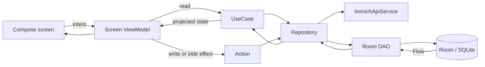
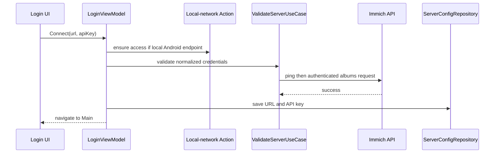

# ImmichGallery Architecture

This document is the system-level architecture map for ImmichGallery. It
describes the repository as it exists today and routes detailed feature work to
the focused contracts under `docs/ai/`. It is not a product roadmap or a
proposed redesign.

## 1. Project Classification

ImmichGallery is a shared-first Kotlin Multiplatform client application with
native Android and iOS hosts and a first-class JVM Desktop target. It is a
read-only companion for self-hosted Immich servers: users can authenticate,
browse cached and live library views, inspect media, and play videos, but the
app does not mutate the Immich library.

The repository contains two Gradle modules and one Xcode host:

- `composeApp` owns shared application code, Compose UI, domain logic, data
  access, Room, platform implementations, and the JVM Desktop application. Its
  Android target is a KMP library.
- `androidApp` is the thin installable Android application and depends on
  `composeApp`.
- `iosApp` is the Swift/Xcode host for the static `ComposeApp` framework.

## 2. Product Scope

The current user-facing feature set is:

- API-key login to a self-hosted Immich server;
- Timeline browsing grouped by month or day;
- Album and People collection lists;
- cached-first paginated Album and Person detail galleries;
- an Explore shell destination retaining smart and filename search, plus live
  owner-filtered Favorites and current-date OnThisDay Memories collections;
- justified-row and optional Mosaic photo-grid layouts;
- full-screen image/video paging, image zoom, asset information, and slideshow;
- Android foreground notification support for explicit Timeline synchronization
  and tracked blocking preparation work;
- local Room caching for gallery data and optional layout artifacts.

Only `IMAGE` and `VIDEO` assets enter the gallery domain. Hidden Timeline
assets, audio, and other unsupported asset types are filtered at data
boundaries. Explore Search results, Favorites, current-date Memories, and
expanded asset information are live server data;
they are not independent Room-backed caches.

The deliberate non-goals are server mutation operations: upload, edit,
favorite, delete, share, and download are not implemented. ImmichGallery also
does not provide user/password login or administer an Immich server.

## 3. Technology Stack

| Area | Current technology |
| --- | --- |
| Language | Kotlin 2.4.10; Swift for the iOS host |
| Shared UI | Compose Multiplatform 1.11.1 and Material 3 |
| Targets | Android, iOS ARM64 device/simulator, JVM Desktop |
| Navigation | JetBrains Navigation Compose with serializable typed routes |
| Networking | Ktor 3.5.1 with OkHttp, Darwin, and Java engines |
| Serialization | kotlinx.serialization 1.11.0 |
| Images | Coil 3.5.0; authenticated OkHttp/Ktor fetchers |
| Video | Platform `PlatformVideoPlayer` implementations; Compose media player on Android/JVM and AVPlayer on iOS |
| Persistence | Room 2.8.4, bundled SQLite 2.7.0, KSP 2.3.10 |
| Dependency injection | Koin 4.2.2 |
| Settings | `multiplatform-settings` 1.3.0 |
| Time | kotlinx-datetime 0.8.0 and `kotlin.time.Clock` |
| Logging | `kmlogging` 2.0.3 |
| Build | Gradle wrapper, Android Gradle Plugin 9.3.0, Xcode host project |

The complete dependency versions live in `gradle/libs.versions.toml`.

## 4. Repository Structure

```text
ImmichGallery/
+-- androidApp/                 # Installable Android application shell
+-- composeApp/
|   +-- schemas/                # Exported Room schemas
|   +-- src/
|       +-- commonMain/         # Shared data, domain, UI, DI, resources
|       +-- androidMain/        # Android actuals, Activity, Application, service
|       +-- iosMain/            # iOS actuals and UIKit bridge
|       +-- jvmMain/            # Desktop actuals and application entry point
|       +-- commonTest/         # Portable tests executed by platform test tasks
|       +-- androidDeviceTest/  # Instrumented Room migration verification
+-- iosApp/                     # SwiftUI host and Xcode configuration
+-- docs/ai/                    # Focused durable architecture/workflow contracts
+-- docs/timeline.md            # Timeline rendering and interaction contract
+-- gradle/                     # Wrapper and version catalog
+-- .agents/                    # Project-local TRIP skills and runtime
```

The shared package is organized by dependency role:

```text
composeApp/src/commonMain/kotlin/com/udnahc/immichgallery/
+-- data/
|   +-- local/                  # Room database, DAOs, entities, migrations
|   +-- model/                  # Immich wire-response models
|   +-- remote/                 # HTTP client and Immich API service
|   +-- repository/             # API, Room, and settings coordination
+-- domain/
|   +-- model/                  # Domain models, mapping, grid algorithms
|   +-- usecase/                # Reads and transformations
|   +-- action/                 # Writes and side effects
+-- ui/
|   +-- component/              # Shared Compose components
|   +-- navigation/             # Startup, shell, routes, navigation ViewModels
|   +-- screen/                 # Feature screens and screen ViewModels
|   +-- theme/                  # Theme and shared dimensions
|   +-- util/                   # Gestures, scheduling, transitions, platform seams
+-- di/                         # Shared and platform Koin modules
```

## 5. Core Architecture Principles

The dependency direction is:

```text
Immich API / Room / settings
  -> repositories
  -> read UseCases and write/side-effect Actions
  -> screen ViewModels and layout coordinators
  -> Compose screens and components
```

The durable boundaries are:

- Repositories own access to `ImmichApiService`, Room DAOs, and settings.
- UseCases represent reads and focused transformations.
- Actions represent writes, cache mutation, synchronization, or another side
  effect.
- ViewModels inject UseCases and Actions, not repositories.
- Composables render projected state and forward user intent. They do not query
  repositories, perform network/Room operations, or run photo-grid algorithms.
- `commonMain` is preferred. `expect`/`actual` is reserved for behavior that
  genuinely requires platform APIs.
- `Dispatchers.IO` owns network and imperative database work;
  `Dispatchers.Default` owns expensive pure projection and layout work.
- Suspend `Result` boundaries preserve structured concurrency by rethrowing
  `CancellationException` through the shared result helper.

Detailed implementation rules live in `docs/ai/feature-implementation.md`.

## 6. Application Composition And Dependency Injection

`App.kt` is the shared composition root. It observes `AppLifecycle`, installs
`ImmichGalleryTheme`, configures the singleton Coil image loader from Koin, and
renders `AppNavigation`.

`di/AppModule.kt` provides:

- one shared `Settings` instance;
- the shared Ktor client and `ImmichApiService`;
- Room-backed and live repositories;
- read UseCases and write/side-effect Actions;
- screen ViewModels;
- shared sync, Mosaic, and overlay coordinators.

`platformModule()` provides the platform Room database and native services.
Android starts process-level Koin in `ImmichGalleryApplication` because the
foreground service must resolve shared coordinators without Compose being the
only owner. iOS and JVM create their Koin application around the shared
composition through platform `AppKoin` implementations.

## 7. Startup, Authentication, And Session Ownership

`AppNavigation` blocks on `AppStartupViewModel` until the app resolves Login or
Main. A saved session is simply a non-blank normalized server URL plus API key
in `ServerConfigRepository`, backed by `multiplatform-settings`.

Login follows this sequence:

1. Validate non-empty URL and key.
2. Normalize the URL by removing trailing slashes.
3. Resolve Android local-network permission when applicable.
4. Call public `/api/server/ping`.
5. Validate the API key with authenticated `/api/albums`.
6. Persist the normalized URL and key only after validation succeeds.

Android API 37 and newer requests `ACCESS_LOCAL_NETWORK` for endpoints
classified as local. iOS declares local-network usage and permits local-network
HTTP through ATS. JVM has no platform permission gate.

`MainScreenViewModel` owns server reachability monitoring and logout. Monitoring
runs only while Main is composed and the platform lifecycle is active. Logout
is cache-first and configuration-last: server-scoped Room data is cleared before
credentials and view preferences. A cache-clear failure leaves the session
active and retryable so data cannot be exposed under a different server.

See `docs/ai/auth-session.md` for the complete contract.

## 8. Navigation And Screen Ownership

Navigation uses `@Serializable` routes:

- `LoginRoute`
- `MainRoute`
- `TimelineRoute`
- `AlbumsRoute`
- `PeopleRoute`
- `ExploreRoute`
- `FavoritesRoute`
- `MemoriesRoute`
- `AlbumDetailRoute(albumId)`
- `PersonDetailRoute(personId, personName)`

The Main shell owns Timeline, Albums, People, and Explore tabs. Album, Person,
Favorites, and Memories destinations sit above that shell. Screen
ViewModels own loading, error, refresh,
pagination, layout projection, and viewer-source state for their feature.

| Feature | UI owner | State/domain owner | Data owner |
| --- | --- | --- | --- |
| Startup/login | `AppNavigation`, `LoginScreen` | startup/login ViewModels and auth UseCases/Actions | config, auth, and local-network services |
| Main session | `MainScreen` | `MainScreenViewModel` | status and cache-first logout Actions |
| Timeline | `TimelineScreen` | `TimelineViewModel`, manual-sync coordinator, Timeline UseCases/Actions | Timeline and Timeline Mosaic repositories |
| Albums list | `AlbumListScreen` | `AlbumListViewModel` | `AlbumRepository` and Room |
| Album detail | `AlbumDetailScreen` | `AlbumDetailViewModel`, detail layout coordinator | album/detail repositories and Room |
| People list | `PeopleScreen` | `PeopleViewModel` | `PeopleRepository` and Room |
| Person detail | `PersonDetailScreen` | `PersonDetailViewModel`, detail layout coordinator | people/detail repositories and Room |
| Explore/Search | `SearchScreen` | `SearchViewModel`, `SearchCriteria`, and `SearchAssetsUseCase` | live `SearchRepository` calls |
| Favorites | `FavoritesScreen` | `FavoritesViewModel`, owner/Favorites UseCases | live auth and metadata-search calls |
| Memories | `MemoriesScreen` | `MemoriesViewModel`, local-date Memories UseCase | live date-filtered Memories calls |
| Media viewer | overlay hosts and media components | static or Timeline overlay coordinator | asset detail, Coil, platform video player |
| Stack browsing | nested viewer-local stack session | source ViewModel or Timeline overlay coordinator | live asset-detail and stack reads |

## 9. Immich API Boundary

`ImmichApiService` is the shared typed API boundary. It currently calls:

- `/api/server/ping` and `/api/server/version`;
- `/api/users/me`;
- `/api/timeline/buckets` and `/api/timeline/bucket`;
- `/api/albums` and `/api/albums/{id}`;
- `/api/people`;
- `/api/search/metadata` for album assets, person assets, advanced metadata
  criteria, and owner-filtered Favorites;
- `/api/search/smart` for natural-language criteria with shared metadata
  filters;
- `/api/assets/{id}` and `/api/assets/{id}/edits`;
- `/api/stacks/{id}` after an authoritative `/api/assets/{id}` stack lookup.
- `/api/memories` with an exact local date-only `for=YYYY-MM-DD` query.

Authenticated requests use `x-api-key`. The Ktor client ignores unknown JSON
fields, uses a 15-second connection timeout, and uses 60-second request and
socket timeouts. Timeline endpoints are treated as an internal Immich
compatibility surface: decode/column-shape failures become typed errors that
include the server version and endpoint for diagnostics rather than rejecting
unknown versions pre-emptively.

Paginated code follows the server's returned `nextPage` token and does not
synthesize page numbers from local assumptions. Repository writes occur only
after API responses have been filtered, mapped, and enriched as required.

## 10. Persistence And Cache Ownership

Room database `immich_gallery.db` is schema version 2. It contains shared asset
rows plus Timeline, Album, and Person relationships; sync metadata; and
Timeline/detail Mosaic artifacts. Exported schemas live in
`composeApp/schemas/`.

Every platform database builder uses:

- `BundledSQLiteDriver`;
- `setQueryCoroutineContext(Dispatchers.IO)`;
- the explicit no-op `MIGRATION_1_2`;
- `fallbackToDestructiveMigration(true)` for unsupported gaps.

Destructive fallback is acceptable only because Room contains re-fetchable
server data and derived artifacts. If durable user-authored data is added, its
migration and recovery policy must be redesigned before using these rules.

Repositories expose Room `Flow` for observed data and suspend calls for
imperative reads/writes. Multi-table relationship replacement and scoped cache
invalidation are transactional. Cached rows reconstruct URLs from the current
server configuration where possible so a stale origin is not embedded in
domain objects.

Cache ownership by feature:

- Timeline: bucket metadata, ordered asset relationships, assets, sync state,
  and optional Timeline Mosaic artifacts.
- Albums: list metadata and opened-album asset relationships.
- People: list metadata and opened-person asset relationships.
- Detail Mosaic: owner-scoped artifacts for Album and Person detail.
- Settings: credentials, grouping, row density, and Mosaic preferences remain
  in `multiplatform-settings`, not Room.
- Explore Search, Favorites, current-date Memories, expanded asset information,
  and viewer stack member lists: live-only.

See `docs/ai/data-cache-time.md` for cache and transaction invariants.

## 11. Timeline Synchronization

Timeline distinguishes three modes:

- **Cold sync:** blocking; fetches metadata and every bucket, writes cache, and
  optionally prepares persisted Mosaic artifacts before marking completion.
- **Cached launch:** renders Room metadata and materializes visible/target
  buckets on demand. The current cache-only warm policy does not contact the
  server for Timeline changes.
- **Manual refresh:** explicit full metadata and bucket refresh initiated from
  the top bar; cached rows remain visible and failed buckets retry once.

Android manual refresh is executed by `SyncForegroundService` through
`TimelineManualSyncCoordinator`. iOS and JVM execute the same coordinator from
the ViewModel. Changed bucket content drives scoped invalidation; a successful
no-op refresh must not rewrite equivalent data, bump layout revisions, or clear
Mosaic/row projections.

The authoritative algorithm and failure rules are in
`docs/ai/timeline-sync.md`; Timeline rendering and scroll targeting are in
`docs/timeline.md`.

## 12. Album, Person, Explore, Favorites, And Memories Data Flow

Album and People collection lists observe Room as their source of truth and
refresh from the server while retaining cached content. Removed owners clear
their relationships, detail sync metadata, and Detail Mosaic artifacts in the
same transaction that replaces the list.

Album and Person detail screens are cached-first. Opening a detail screen
materializes cached ordered assets, refreshes that owner, and paginates using
server tokens. A changed page truncates stale later relationship rows so cached
and fresh pages cannot form a mixed snapshot. Person detail data is fetched
only after opening a person; list synchronization does not preload every face's
assets.

Search calls the server live through one normalized `SearchCriteria` contract.
A nonblank Context query selects Smart Search; filename, description, OCR, and
filter-only criteria select Metadata Search before any network I/O. The
submitted session freezes the normalized criteria, endpoint, generation, and
page state so visible edits cannot alter an in-flight request. Failed next
pages remain explicitly retryable rather than entering an automatic retry
loop, and successfully consumed pages cannot be replayed.

Explore replaces the Search shell route without replacing `SearchViewModel`,
its density setting, or its pagination/viewer behavior. Its blank idle state
adds static Favorites and Memories cards. The cards do not prefetch either
collection; each live collection starts only after its root destination is
opened.

Favorites resolves `/api/users/me`, then follows live favorite metadata-search
pages. It filters every response by the authenticated owner id, consumes sparse
partner/unsupported pages within one logical claim, and retains both consumed
pages and the first unconsumed retry page on failure. Favorites uses its own
justified-row density setting and the shared static viewer/stack session.

Memories derives the current date from `Clock.System.now()` in the current
system time zone when its root destination opens or explicitly retries. It
performs one live `/api/memories` read, keeps only supported image/video
OnThisDay memories, and orders separate cards by descending year with stable
server order inside a year. It does not write Room, mark memories seen/saved,
or alter Timeline cold, cached, or manual synchronization.

See `docs/ai/collection-lists-search.md` and
`docs/ai/album-person-detail.md`.

## 13. Photo-Grid Rendering

Photo-grid layout is projected before Compose.

### Justified rows

`packIntoRows(...)` converts ordered assets into full-width `RowItem` values.
Screen ViewModels own width, row-height configuration, invalidation, and the
resulting display list. Touch pinch and Desktop Ctrl/Cmd-wheel gestures adjust
row density through debounced settings writes.

### Mosaic

`MosaicRenderEngine` is the shared domain engine for template assignment,
progressive chunks, exact geometry, display projection, and completed fallback
rows. Timeline uses bucket-scoped scheduling and artifacts; Album/Person detail
uses owner/group-scoped scheduling and artifacts. Repositories persist and
validate engine output but do not implement assignment math.

Mosaic can run from persisted artifacts or render-demand in-memory work. Cache
keys include configuration, ordered asset fingerprints, geometry inputs, and
artifact version. Pending or failed work renders geometry-preserving
placeholders; completed fallback is a deterministic cropped full-width row, not
a partial Mosaic band.

Canonical references:

- `docs/ai/row-packing.md`
- `docs/ai/mosaic-rendering.md`
- `docs/ai/mosaic-assignment.md`
- `docs/ai/mosaic-runtime.md`

## 14. Media Loading And Viewer

Coil loads authenticated thumbnails and still images. Android uses an OkHttp
fetcher; iOS and JVM use Ktor-backed image networking. Grid thumbnails use
bounded requests and stable cache keys, while viewer stills request the edited
original with a thumbnail transition/loading source.

The full-screen viewer preserves the source ordering. Its default return policy
targets the currently settled asset. Memories explicitly uses origin mode so a
non-cover page returns to the selected cover card. Timeline has a lazy-bucket
overlay coordinator; Search, Favorites, Memories, and Album/Person detail use a
static materialized pager. Shared transitions retain the selected grid content
through exit animation.

Video authentication differs by platform:

- Android supplies the API key as an HTTP header.
- JVM appends Immich's supported `apiKey` query parameter because desktop
  libVLC does not reliably forward custom headers.
- iOS sends the header through `AVURLAsset`, tries the original media first,
  and falls back to Immich playback/transcode after failure or stall.

Expanded asset information is fetched on demand and not persisted. Slideshow
state is shared; platform wake-lock implementations keep the screen awake only
while a slideshow is active.

The overflow menu can resolve the settled asset's current stack on demand. A
positive cached count exposes **View stack** immediately; otherwise opening the
menu performs one viewer-scoped authoritative preflight. A nested stack session
reuses the static viewer for normalized supported members, disables recursive
stack entry, pauses the covered base viewer, and closes before the base viewer.
Stack members never enter source grids, Room relationships, Timeline ordering,
or Mosaic artifacts, and dismissing the nested session preserves the base
viewer's existing grid return target.

See `docs/ai/media-viewer.md`.

## 15. Platform Boundaries

Shared `expect`/`actual` seams cover:

- Room database construction;
- Ktor engine construction;
- Koin composition/platform modules;
- authenticated image-loader setup;
- platform video playback;
- lifecycle, wake lock, haptics, back handling, edge-to-edge, desktop input,
  system-gesture exclusion, and sync notification behavior.

### Android

`androidApp` owns application ID, versions, launcher manifest, packaging, and
the installable APK. `composeApp` owns `ImmichGalleryApplication`,
`MainActivity`, the foreground sync service, Android actuals, and resources.
Android supports API 24 and newer and targets API 37.

### iOS

The SwiftUI app hosts `MainViewController()` from the static Kotlin framework.
The project currently builds ARM64 device and ARM64 simulator targets and sets
the deployment target to iOS/iPadOS 18.2. The Xcode build phase calls
`iosApp/scripts/compile-kotlin-framework.sh`, which skips Gradle only when the
framework is newer than all relevant shared/Apple inputs.

### JVM Desktop

`main.kt` owns a single Compose Desktop window and maps window focus into the
shared lifecycle. Native distributions support DMG, MSI, and DEB on applicable
hosts.

## 16. Configuration, Versioning, And Security

Runtime configuration surfaces are:

- saved server URL, API key, and view preferences in
  `multiplatform-settings`;
- optional development Login defaults generated from gitignored
  `local.properties`, Gradle properties, or environment variables;
- Android permissions and components in the merged `androidApp`/`composeApp`
  manifests;
- iOS product, signing, local-network, and deployment configuration in
  `iosApp`.

Developer default inputs are build inputs only and do not bypass server
validation. Real credentials must never be committed or logged. The Ktor
logging plugin is disabled (`LogLevel.NONE`). The app allows cleartext Android
traffic and local-network iOS HTTP for trusted self-hosted LAN servers; HTTPS is
the expected transport outside a trusted network.

The API key is application configuration stored by `multiplatform-settings`,
not a Room row and not a server session token managed by a platform secure
credential vault. Desktop video may place it in the playback URL query because
of libVLC header limitations; logs and diagnostics must therefore avoid media
URLs containing credentials.

Current version surfaces are:

- Android: `versionCode = 2`, `versionName = "1.1.0"` in
  `androidApp/build.gradle.kts`;
- iOS: `CURRENT_PROJECT_VERSION=2`, `MARKETING_VERSION=1.1.0` in
  `iosApp/Configuration/Config.xcconfig`;
- Desktop: `packageVersion = "1.1.0"` in `composeApp/build.gradle.kts`.

Release work must update and verify every platform version in scope. The
repository's default branch is `master`.

## 17. Build And Packaging

Common development commands are:

```bash
# Shared/JVM compilation
./gradlew :composeApp:compileKotlinJvm

# Android KMP library compilation and host tests
./gradlew :composeApp:compileAndroidMain
./gradlew :composeApp:testAndroidHostTest

# Installable Android application
./gradlew :androidApp:assembleDebug
./gradlew :androidApp:lintDebug

# Apple compilation
./gradlew :composeApp:compileKotlinIosArm64
./gradlew :composeApp:compileKotlinIosSimulatorArm64

# Desktop development and packaging
./gradlew :composeApp:run
./gradlew :composeApp:packageReleaseDistributionForCurrentOS
```

iOS application builds use the `iosApp` Xcode scheme and its Kotlin framework
build phase. Gradle daemons must be stopped with `./gradlew --stop` after
command-line Gradle work.

The current Android release build is not production-signed: minification is
disabled and the release build uses the debug signing configuration. Packaging
or store release work must treat that as an explicit unresolved release
boundary.

## 18. Testing And Verification Strategy

The automated test dependencies are `kotlin.test`, JUnit 4.13.2, and
`kotlinx-coroutines-test`. Tests are currently organized as:

- `composeApp/src/commonTest`: API contracts, repositories, domain algorithms,
  Actions, ViewModels, grid projection, Mosaic scheduling, pagination, sync,
  and UI-helper contracts;
- `composeApp/src/androidDeviceTest`: the Room 1-to-2 migration test using the
  bundled SQLite driver.

There are currently no project test files under `jvmTest`, `iosTest`, or
`androidHostTest`; shared `commonTest` tests execute through the platform test
tasks. No code-coverage plugin or minimum percentage is configured.

Useful verification commands are:

```bash
# Fast shared host suite
./gradlew :composeApp:jvmTest

# Shared tests through the Android host target
./gradlew :composeApp:testAndroidHostTest

# iOS simulator test executable
./gradlew :composeApp:iosSimulatorArm64Test

# Device-only Room migration test; requires a connected Android target
./gradlew :composeApp:connectedAndroidDeviceTest
```

Verification is risk-based:

- shared data/domain/UI behavior needs focused tests plus relevant shared
  compilation;
- Room schema/migration work needs exported-schema review and the device test;
- Android launcher/service/permission work needs app assembly/lint and, when
  behavior matters, device verification;
- iOS host, local-network, AVPlayer, or lifecycle work needs Xcode and relevant
  simulator/device verification;
- Desktop media/input/packaging changes need the packaged or running Desktop
  application, not compilation alone;
- user-visible flows must be traced through their actual actions and state
  wiring; a successful compile is necessary but not sufficient.

The repository rule is not to run device/simulator checks unless the current
request explicitly asks for them. Report those checks as unperformed when they
remain relevant.

## 19. Performance And Concurrency

Performance-sensitive architecture is concentrated in cache-first loading and
precomputed photo-grid projections:

- Room flows supply cached content before refresh where supported.
- Expensive grouping, row packing, Mosaic work, search/list filtering, and
  display-index construction stay outside composables.
- `PhotoGridLayoutRunner` debounces/cancels zoom-driven layout projection.
- `MosaicWorkScheduler` prioritizes visible detail groups over offscreen work.
- Timeline pauses new Mosaic demand during active scrolling and performs
  bounded visible/nearby materialization after settling.
- Image requests use bounded thumbnail decode sizes in grids.
- Pagination guards duplicate requests and follows terminal server tokens.
- Network/database work is dispatched away from the UI thread.

Compose performance and correctness audits use
`docs/ai/compose-performance-audit.md`; unmeasured optimization ideas are not
treated as confirmed defects.

## 20. Error Handling And Observability

ViewModels expose typed UI messages, loading state, retry state, and banners.
Cached screens remain visible when refresh fails. Cancellation remains control
flow rather than being converted to a connection/content error.

Timeline compatibility failures carry endpoint and server-version context.
Cold Timeline failures retain a blocking retry state, while warm/detail/list
refresh failures preserve cached rows. Manual Timeline refresh aggregates
bucket failures after bounded retry.

The project uses local multiplatform logging and has no remote analytics or
crash-reporting subsystem in the repository. Logs must not include API keys or
credential-bearing playback URLs.

## 21. Data-Flow Diagrams

### Normal cached feature flow



### Login and session transition



### Timeline manual refresh

```mermaid
sequenceDiagram
    participant User
    participant Host as ViewModel or Android service
    participant Coordinator as TimelineManualSyncCoordinator
    participant Action as TimelineManualSyncAction
    participant API as Immich API
    participant Room
    participant UI as TimelineViewModel state

    User->>Host: refresh
    Host->>Coordinator: request current config and geometry
    Coordinator->>Action: run full refresh
    Action->>API: fetch metadata and every bucket
    Action->>Room: transactional changed-content writes
    Action->>Action: retry failed buckets once
    Action-->>Coordinator: structured changed/removed/failure result
    Coordinator-->>UI: event/result
    UI-->>User: keep cache visible; publish changes and banner
```

## 22. Documentation Ownership

Use this file for cross-system ownership, dependency direction, platform
boundaries, build/version surfaces, and architecture diagrams. Keep detailed
behavior in its canonical focused document:

| Area | Canonical document |
| --- | --- |
| Architecture and source ownership | `docs/ai/architecture.md` |
| Authentication and session | `docs/ai/auth-session.md` |
| Data, cache, API, and time | `docs/ai/data-cache-time.md` |
| Collection lists and Search | `docs/ai/collection-lists-search.md` |
| Album and Person detail | `docs/ai/album-person-detail.md` |
| Timeline rendering | `docs/timeline.md` |
| Timeline synchronization | `docs/ai/timeline-sync.md` |
| Justified rows | `docs/ai/row-packing.md` |
| Mosaic overview/assignment/runtime | `docs/ai/mosaic-rendering.md`, `docs/ai/mosaic-assignment.md`, `docs/ai/mosaic-runtime.md` |
| Media viewer | `docs/ai/media-viewer.md` |
| UI/Compose rules | `docs/ai/ui.md` |
| Implementation workflow | `docs/ai/feature-implementation.md` |
| Audit workflow | `docs/ai/audit.md`, `docs/ai/compose-performance-audit.md` |

Do not duplicate a feature's detailed algorithm here. Update this document when
a change alters system ownership, dependency direction, module/source layout,
persistence classification, platform responsibilities, build/version surfaces,
or cross-feature data flow.
